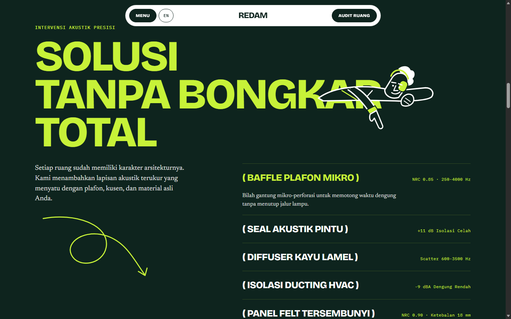
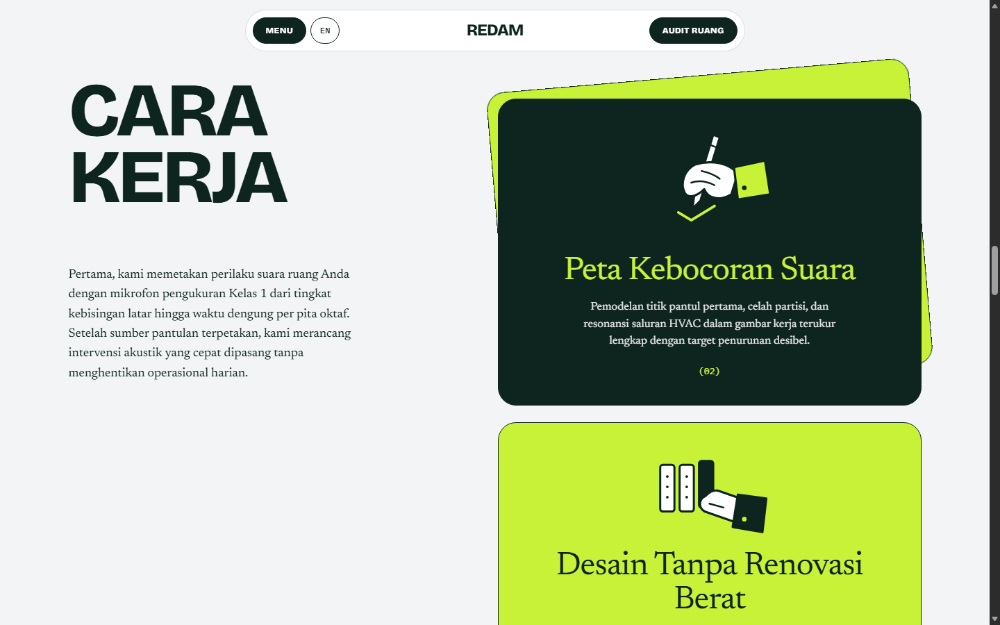

# REDAM · Architectural Acoustics & Urban Noise Engineering Studio

**Live Demo:** [https://redam-acoustics.vercel.app](https://redam-acoustics.vercel.app) · **Repository:** [github.com/MrEuwn/redam-acoustics](https://github.com/MrEuwn/redam-acoustics)

> **Project Status:** `Self-initiated` (Awwwards-grade 3-ink editorial storytelling portfolio showcase accompanying [Rumah Wiraloka](https://wiraloka-batik.vercel.app)).

Architectural acoustics and urban noise engineering studio showcase built with React and Vite, featuring full bilingual Indonesian / English (`ID / EN`) switching, bespoke 3-ink risograph illustrations, native CSS `linear()` spring card physics, gesture-gated Web Audio dampening simulation, and a live Sabine `RT60` room acoustic estimator.

## Visual Previews

| 3-Ink Editorial Hero & Live Dampen Mode | Deep Pine Polarity Flip & Mascot-on-Type |
| :---: | :---: |
|  |  |



## Visual Direction & Craft

- **Strict 3-Ink Editorial Risograph Palette**: Cool Mineral Chalk (`#F2F4F6`), Deep Pine Obsidian (`#0E241E`), Electric Chartreuse (`#C7F238` exclusively on dark grounds or solid cards), and Deep Pine Signal (`#0B6B56`) on light grounds for WCAG AA+ contrast.
- **Typography**: `Bricolage Grotesque` (800 uppercase tight-tracked display), `Newsreader` (editorial serif regular & italic in readable sentence case), and `IBM Plex Mono` (`tabular-nums` acoustic telemetry).
- **Interactive Craft**:
  - Morphing floating island navigation bar with live Indonesian / English (`ID / EN`) switching.
  - Hero `MODE REDAM` (`DAMPEN MODE`) interactive switch with animated 3-ink risograph character, morphing acoustic waveforms, and optional gesture-gated Web Audio API room-noise dampening simulation.
  - Scroll-scrubbed SVG spiral arrow, wave manifesto underlines, and studio duotone portrait loop with full `prefers-reduced-motion` support.
  - Live Sabine `RT60` Room Acoustic Estimator modal (`RT60 = 0.161 * V / A`) with downloadable `.txt` baseline brief.

## Local Development

```bash
npm install
npm run dev
```

Runs on `http://localhost:5183`.

## Production Build

```bash
npm run build
npm run preview
```
